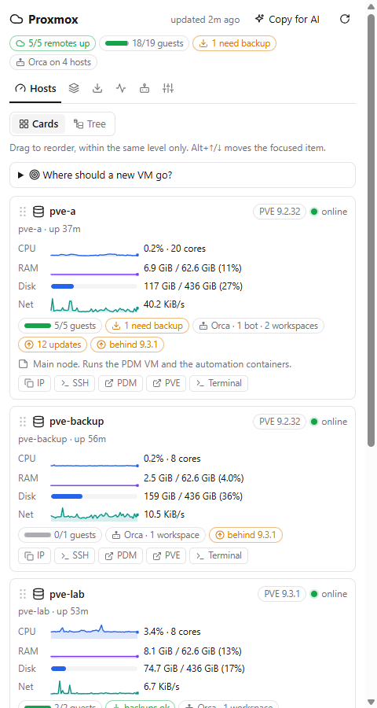
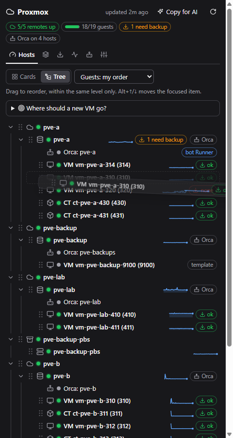
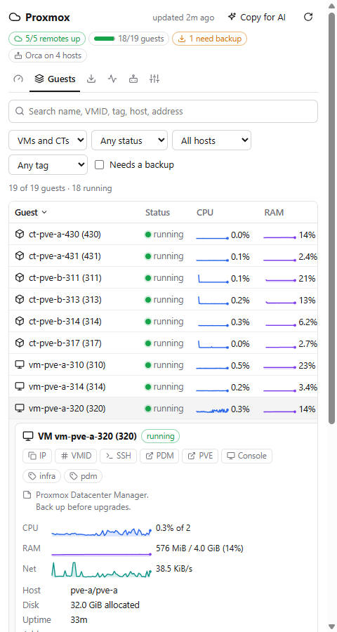
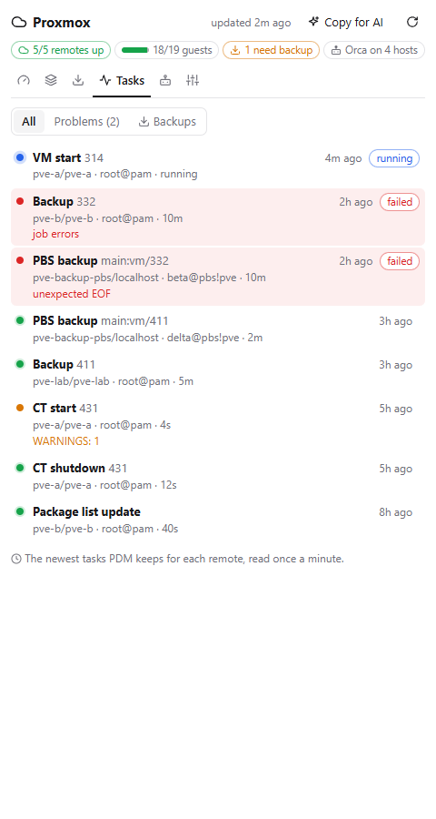
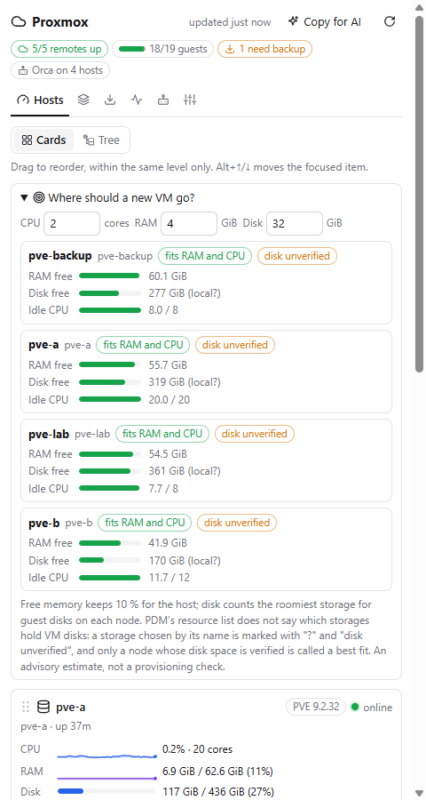
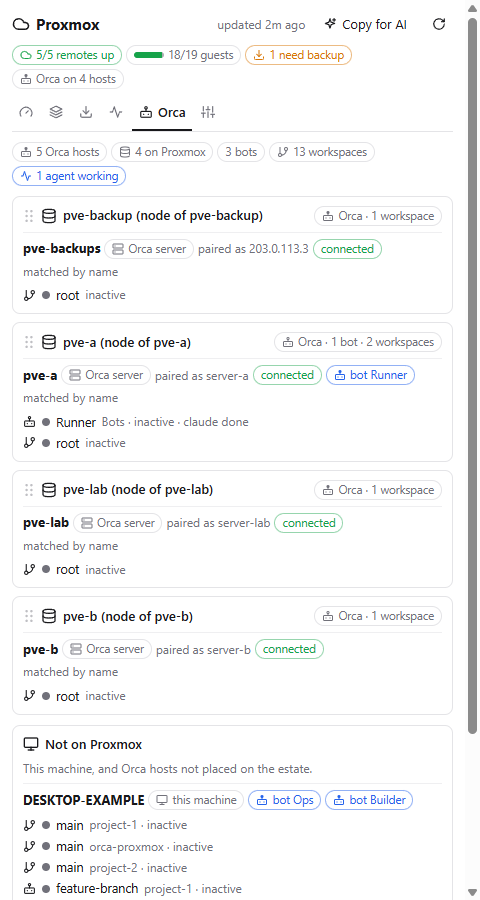
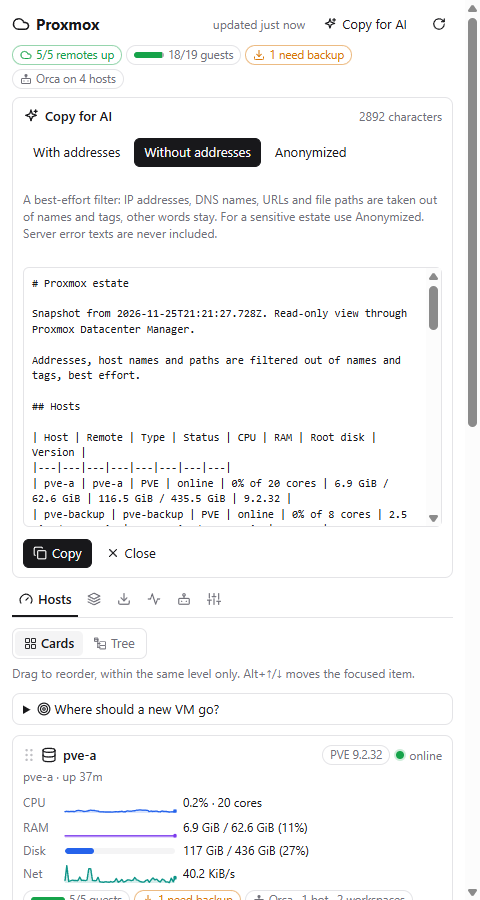

# Proxmox for Orca

An [Orca](https://github.com/stablyai/orca) plugin that shows your Proxmox estate in Orca's right
sidebar: every PVE host, VM and container, your Proxmox Backup Server datastores, and when each
guest was last backed up. It reads everything through
[Proxmox Datacenter Manager](https://pdm.proxmox.com/) (PDM), which already aggregates many PVE
clusters and PBS servers, so one read-only API token is all it needs.

It is **read-only**: it only sends `GET` requests, and the token it needs cannot change anything.

## Screenshots

Rendered from the bundled example estate (no real servers):

<p>
  
  
  
  
  
  
  
</p>

To try the panel without Orca or a server, run `npm run harness` and open http://127.0.0.1:47913/
(light) or /dark.html: the same example estate, including drag and drop.

## Install

In Orca 1.4.248 or newer:

```sh
orca plugin install wizhelp/orca-proxmox
```

Orca shows what the plugin asks for (its own storage, settings and encrypted secrets, desktop
notifications, and a worker that runs on your machine) and prints the command to approve it. The full URL
(https://github.com/wizhelp/orca-proxmox) works too, as does a local clone
(`orca plugin install ./orca-proxmox`). Then open the **Proxmox** panel in the right sidebar and
follow [Setup](#setup).

## Features

- **Hosts**: a card per PVE node and PBS server with **sparklines of the last hour** for CPU,
  memory and network, a root disk bar, uptime and version, a bar of running vs stopped guests,
  their backup state, and whether Orca runs there. Or as a **tree**: remote → node → Orca hosts
  and guests, each line with its status, a small CPU chart, backup state and Orca badge; select a
  guest for its details right below it.
- **Drag and drop**: rearrange the cards and the tree by dragging. The dragged item lifts as a
  see-through copy, nudged and tilted slightly to the side, while the others glide out of the way;
  on release it settles into place. Each level moves only among itself (remotes; the nodes of one
  remote; the guests of one node); dragging out of its list cancels and everything glides back.
  Mouse anywhere on a row or card header, touch and pen by the ⋮⋮ grip; Alt+↑/↓ moves the focused
  item; Esc cancels. The order is saved and shared by the cards, the tree and the Orca tab;
  *Reset order* goes back to PDM's. The tree can also order guests by name, status, CPU, memory
  or backup age.
- **Guests**: every VM and container with status, a CPU sparkline, a memory bar, uptime and
  backup state. Search by name, VMID, tag, host or address; filter by type, status and host; sort
  any column; select a row for its charts and details.
- **Backups**: PBS datastore usage with its last day as a chart, and each guest's newest PBS
  snapshot as a bar against the age limit. A guest with no snapshot in the last 26 hours
  (configurable) is flagged; templates are listed but never flagged; snapshots whose guest is gone
  are listed apart.
- **Orca**: which of Orca's hosts (this machine, SSH targets, paired servers) run on which node or
  guest, with their bots and workspaces and the state of each workspace's agents. Nodes and
  guests running Orca get a badge everywhere. See [Orca awareness](#orca-awareness).
- **Actions** on every host and guest: copy its address(es), VMID or a ready ssh command (through
  the node, `ssh -J root@<node> root@<guest>`, when the guest is on a private network; offered only
  for addresses that are strictly an IP or a DNS name); open it in PDM or the Proxmox web
  interface, or a guest's console; open an Orca terminal where Orca runs.
- **Tasks**: the newest tasks of every remote (starts, stops, backups, updates), failures in red
  with their error; filters for problems and backups.
- **Tags and notes**: Proxmox tags on guests, with a tag filter; the notes of guests and nodes.
- **Warnings**: container disks over 85 %, datastores over 80 % and storages over 85 %, with "full
  in ~N days" when the history shows a steady rise; pending package updates and version drift
  between hosts.
- **Where should a new VM go?**: free memory, disk and CPU per node for a VM of a given size, best
  fit first.
- **Copy for AI**: a clean Markdown summary of the estate (hosts, guests with tags, state and
  addresses, backups, warnings, where Orca runs) to paste into an agent, shown first and copied on
  request: with addresses; without addresses, a **best-effort filter** that takes IP addresses,
  DNS names, URLs and file paths out of names and tags but cannot recognize every way of writing
  them; or anonymized (every name a placeholder, no tags, VMIDs or addresses), **the mode to use
  for a sensitive estate**. Server error texts are never included, statuses and versions are
  projected to known values, and names and tags are escaped plain text (escaping keeps out
  markup, not meaning: review the preview before pasting).
- **Status bar** (`● 5/5 · 1 backup stale`): remotes up and the main issue, kept current in the
  background; pressing it opens the panel.
- **Alerts**: Orca notifications when a remote goes offline, a running guest stops, a backup fails
  (when its task ends, also if it was seen running before) or a backup goes stale; each told once
  (outages after two consecutive refreshes that both succeeded), bundled when many come at once,
  and each kind can be muted under Settings → Plugins → Proxmox. Changing the connection starts
  them from a new baseline.
- **Auto refresh** every 30 seconds (configurable) while the panel is visible, and a clear error
  for an unreachable server, a rejected token, a missing permission or a certificate problem.
- Follows Orca's theme (light and dark) and honours *reduce motion*.

## Requirements

- Orca 1.4.248 or newer.
- Proxmox Datacenter Manager 1.x, reachable over HTTPS from the machine Orca runs on. Tested with
  PDM 1.1.10 (PVE 9.x and PBS 4.x remotes); other 1.x releases use the same endpoints, and
  answers of an unexpected shape are skipped with a warning rather than misread.
- For Orca awareness, terminals and opening the panel from the status bar: Orca's own CLI, which
  ships with Orca (see [Orca awareness](#orca-awareness)).

## Setup

### 1. Create a read-only API token in PDM

1. In the PDM web interface, open **Configuration → Access Control**.
2. Optionally create a dedicated user, e.g. `monitor@pdm`.
3. Under **API Token**, add a token for that user, e.g. `monitor@pdm!orca`. Copy the secret now:
   PDM shows it only once.
4. Under **Permissions**, add the **Auditor** role on the path `/resource` (every remote), or on
   `/resource/<remote>` for each remote you want to see. A token's permissions are the
   intersection of its own and its user's, so add the role for **both** the user and the token.

`Auditor` grants `System.Audit`, `Resource.Audit` and `Access.Audit` and nothing that changes
state. The plugin uses these endpoints, all `GET`:

| Endpoint | Used for |
| --- | --- |
| `/version` | Connection test |
| `/remotes/remote` | The remotes PDM manages |
| `/resources/list` | Nodes, guests and datastores of every remote |
| `/pve/remotes/{remote}/nodes/{node}/status` | PVE version, root disk, uptime |
| `/pbs/remotes/{remote}/status`, `/remotes/remote/{remote}/version` | PBS disk, uptime and version |
| `/pbs/remotes/{remote}/datastore/{store}/namespaces` and `/snapshots` | Last backup per guest |
| `/remotes/tasks/list` | The tasks feed and backup-failure alerts |
| `/pve/remotes/{remote}/updates` | Pending updates, where PDM has checked |
| `/pve/remotes/{remote}/nodes/{node}/config`, guest configs | Notes (and addresses) |
| `/pve/remotes/{remote}/nodes/{node}/rrddata`, `…/qemu|lxc/{vmid}/rrddata`, `/pbs/remotes/{remote}/rrddata`, `…/datastore/{store}/rrddata` | The charts (once a minute) |

If the token sees no remotes, the connection test says so; that almost always means the Auditor
role is missing on the user or the token.

### 2. Get the certificate fingerprint

PDM ships with a self-signed certificate, so the plugin lets you **pin** its SHA-256 fingerprint
instead of trusting a certificate authority. Read it from PDM (the certificate view in the web
interface shows the fingerprint), or from any machine:

```sh
openssl s_client -connect pdm.example.com:8443 </dev/null 2>/dev/null \
  | openssl x509 -noout -fingerprint -sha256
```

Compare what a remote machine reports with what PDM itself shows before you trust it. If your
PDM uses a certificate from a trusted CA, leave the fingerprint empty.

If you connect without a pin to a self-signed server, the panel shows the fingerprint the server
presented and offers to put it in the form, so you can compare it and save.

### 3. Connect

Open the **Proxmox** panel in Orca's right sidebar, go to **Settings**, and enter:

- **Base URL**: `https://pdm.example.com:8443`
- **API token ID**: `monitor@pdm!orca`
- **API token secret**
- **Pinned certificate fingerprint** (optional): `AA:BB:…` (colons and case don't matter)

Press **Test connection**, then **Save**.

Under Orca **Settings → Plugins → Proxmox** you can change the refresh interval (default 30 s),
the backup age warning (default 26 h) and how often PBS snapshot lists are read (default 5 min;
they are the slowest part of a refresh).

## How backups are matched

A PBS snapshot names a guest only by type and VMID (`vm/100`, `ct/101`), not by the cluster it
came from, and VMIDs repeat across clusters. The plugin takes the newest snapshot of that type and
VMID across every datastore and namespace it can read, using two hints to keep clusters apart:

- **Namespace**: a namespace named after a PDM remote (for example `alpha` or `prod/alpha`) holds
  that remote's backups.
- **Owner**: a snapshot owned by a PBS user named after a PDM remote (for example
  `alpha@pbs!pve`, the user that remote's PBS storage logs in as) is that remote's.

A snapshot hinting at one remote is never counted for another remote's guest. Without any hint,
a snapshot of a VMID used on several remotes is still counted, and the match is marked with `?`
as ambiguous. So: give each cluster its own PBS user or namespace, named like its PDM remote.
Only PBS backups count; `vzdump` files on other storage are not checked.

## Orca awareness

The plugin shows where Orca itself runs on your estate: for every Orca host it finds the node or
guest it runs on, and lists the bots and workspaces (with their agents' state) there.

**Where the data comes from.** Orca's plugin API (host API 1.10) has no call for Orca's own hosts
or bots:

- `workspace.list` gives a workspace's `hostId` (`local`, `ssh:<id>`, `runtime:<id>`), but no
  call names those hosts, gives their address, or says which SSH target a paired server was
  deployed through;
- nothing lists bots, or which paired server a bot lives on.

Until it does, the worker reads the same data from the `orca` CLI that ships with Orca
(`orca host list`, `environment list`, `bot list`, `worktree ps`, and `worktree ps
--environment=<server id>` per paired server, three at a time), with `--json`, every 20 seconds
at most. It keeps only names, ids, states and counts; the CLI's output is never logged. Orca starts
plugin workers with a reduced environment, so the worker fills in the variables the CLI needs
(`APPDATA` and friends) from your home directory. Turn it off with **Show where Orca runs** in Orca
Settings → Plugins → Proxmox.

**Which CLI.** The worker runs Orca's CLI by its absolute path, never a bare `orca` (on Linux that
is usually the GNOME screen reader): the one in the running Orca's `resources/bin` (on macOS
`Orca.app/Contents/Resources/bin`), else the usual install folders (on Windows
`%LOCALAPPDATA%\Programs\Orca`, on macOS `/Applications/Orca.app`, on Linux `orca-ide` on PATH,
`~/.local/bin` or `/opt/Orca`). If none is found, Orca awareness, terminals and the status-bar
command say so; reinstall Orca or install its command-line tool and restart Orca.

**One Orca per machine.** Orca keeps two records for a server it deployed its runtime to over
SSH: the SSH target (named by you, renamed at will) and the paired server (named at pairing
time). They are the same Orca, so the plugin shows them as one host named after the SSH target,
with the paired name as a label ("paired as server-b") and the server's workspaces and bots
under it, counted once. The link is the paired server's `orcadDeployment.sshTargetId`. An SSH
target without a paired server, or a paired server not deployed over a known SSH target, stays a
single entry.

**How hosts are placed**, first match wins:

1. **By hand**: the Orca view's *Placement* section sets any Orca host to a node or guest, or to
   "Not on Proxmox".
2. **Through its SSH target**: a paired server not merged with its SSH target (see above) still
   goes where that SSH target goes.
3. **By IP address**, when an Orca host is named by its address: matched against node interface
   addresses and the static addresses in guest configs (LXC `ip=`, cloud-init `ipconfigN`).
4. **By name**: a node, a single-node remote, a guest name or an LXC hostname, ignoring case and
   domain; `pve-backups` also matches `pve-backup`.

Only a unique match counts: a private address used on two clusters places nothing. The CLI gives
no addresses for SSH targets or paired servers, so an Orca host named neither like its machine
nor by its IP needs placing by hand once.

For addresses and notes, the worker reads each node's `/network` and config and each guest's
config (only `name`, `hostname`, `netN`, `ipconfigN` and the notes in `description` are kept)
through PDM, on the backup scan's cadence; the Auditor role covers both.

## Limits

- **Pending updates** come from PDM's own update summary per remote, which PDM fills when it checks
  for updates (its UI does this). PDM's summary of all remotes and the nodes' `apt/update` list need
  more than the Auditor role, so a read-only token cannot ask for a fresh check; until PDM has
  checked, the plugin shows version drift only.
- **Guest disk use** is known for containers only: Proxmox does not see inside a VM's disk.
- **Opening the panel** from the status bar and **opening terminals** go through the `orca` CLI,
  as the plugin API has no call for either yet (see [Orca awareness](#orca-awareness)). A terminal
  on a paired server starts in the background, so the plugin then switches Orca to it; when Orca
  cannot, the panel says which workspace holds it instead of reporting it opened.
- **Links** into the Proxmox web interface use the remote's `web-url` in PDM when set, else a
  node's public address; set `web-url` in PDM when the nodes are only reachable through it.
- **Backups** are judged only by what could be read: when a PBS datastore, namespace or remote
  could not be read (or a datastore has more than 64 namespaces), a guest without a backup found is
  shown as *unknown*, not *never*, and snapshots of guests on an unreachable remote are not called
  orphans.
- **The placement planner** is advisory. PDM's resource list does not say which storages hold VM
  disks. Unless PDM reports a storage's content types, a storage is only ruled out by its name
  (backup, ISO, template, dump) and otherwise counted as *unverified*: its free space is shown, but
  the node is never called a best fit, only a fit for memory and CPU. A node with no possible
  storage shows its disk space as unknown.
- **Large estates.** The first refresh waits for the inventory and every enrichment (backups,
  history, tasks, updates, addresses, Orca), four requests at a time with a 15-second timeout each;
  the panel waits up to two minutes. Very large estates (hundreds of guests, many slow remotes) can
  take longer: the panel then shows an error and the next refresh uses what was read meanwhile.
  History and addresses are read for the first 300 running guests (a warning says when more are
  left out), and a refresh in flight is not cancelled when the panel closes.
- **Notes** of guests and nodes are read only with Orca awareness on (with the addresses), kept in
  the worker's memory and sent to the panel.

## Security

See [SECURITY.md](SECURITY.md) for the details and the residual risks. In short:

- The token secret is stored in Orca's encrypted plugin secrets (backed by the OS keyring),
  sealed with a key only the worker can read, because Orca also lets a plugin's panel read its
  secrets. It is never written to plugin storage or settings, never sent to the panel, and never
  logged. If Orca cannot encrypt secrets on the machine, the plugin refuses to store it.
- With a pinned fingerprint, the TLS handshake finishes and the certificate is compared **before**
  any HTTP is sent, so a mismatched server never sees the token. Without a pin, the system CAs
  and hostname checks apply. Only `https://` URLs are accepted.
- Each saved configuration has its own secret entry; a secret carries over only to the same base
  URL (path included) and token ID, so a token is never sent to a server it was not entered for,
  not even by a refresh that was running while you saved.
- All network calls happen in the plugin's worker; the panel only talks to the worker. Error
  texts are the plugin's own, and everything sent to the panel, logged or notified is scrubbed of
  credential-shaped text first.
- Guest configs can hold cloud-init users, SSH keys and notes: the worker keeps only the name,
  hostname, addresses and notes from them and never logs the rest. Notes are kept in the worker's
  memory and sent to the panel (and they are read only with Orca awareness on).
- Addresses from PDM are used for ssh commands and links only when they are strictly an IP
  address or a DNS name. The orca CLI is run without a shell, with `--flag=value` arguments, some
  of them dynamic (workspace ids, tab titles, a checked ssh command): to read Orca's hosts, bots
  and workspaces, and, when you press them, to open the panel or a terminal.
- Alerts and the status bar run in the plugin's worker; they read what the panel reads and never
  act on Proxmox.

## Development

There is no build step: Orca loads `src/ui/index.html` (with `src/ui/main.ts`) and
`src/worker.ts` as written. The panel is an HTML panel rather than Orca's components, because
those have no drag and drop.

```sh
npm install                 # TypeScript and Node typings, for type-checking only
orca plugin types .         # writes .orca/types (also done by dev load/watch)
npx tsc -p .                # type-check
orca plugin test . --json   # unit tests: recorded PDM answers, a loopback TLS server for pinning
npm run harness             # the panel in a browser with recorded data, to see and drag it;
                            # /listing.html?shot=1|2|3|cover|icon renders the marketplace images
orca plugin dev watch .     # load into Orca (asks you to approve its access first)
```

Tests never contact a real server or run the orca CLI. `test/fixtures/recorded-pdm.ts` and
`recorded-pdm-renamed.ts` hold answers recorded from a real PDM 1.1.10 (scrubbed of public
addresses, fingerprints, guest names and secrets), `test/fixtures/orca-cli.ts` the orca CLI's
answers reduced to the fields read, `test/fixtures/pdm.ts` synthetic ones for edge cases, and
pinning is tested against a local HTTPS server with a throwaway certificate.

Layout:

```
src/ui/index.html        the panel page and its styles (Orca theme variables)
src/ui/main.ts           the panel: header, tabs, refresh, state kept in plugin storage
src/ui/view-*.ts         the Hosts, Guests, Backups, Orca and Settings tabs
src/ui/sortable.ts       animated drag and drop within one level
src/ui/charts.ts         sparklines, meters and stacked bars (SVG)
src/ui/icons.ts          the line icons
src/ui/logic.ts          labels, filters and sorts, tested in Node
src/arrange.ts           the saved order: moves, drops, the estate in that order
dev/harness/             the panel in a plain browser with recorded data
src/worker.ts            config, secrets, request handlers
src/vault.ts             sealing the token secret with a worker-only key
src/scrub.ts             scrubbing what leaves the worker, and the Copy for AI text
src/features/targets.ts  strict IP and DNS name checks for ssh commands and links
src/protocol.ts          panel <-> worker contract
src/model.ts             the normalized estate both sides share, and formatting
src/estate.ts            refresh cadence and backup matching per snapshot
src/proxmox/http.ts      HTTPS transport with certificate pinning
src/proxmox/client.ts    token auth, `{ data }` unwrapping, error mapping
src/proxmox/source.ts    the EstateSource interface (PDM now; single PVE/PBS hosts later)
src/proxmox/pdm.ts       the PDM source
src/proxmox/backups.ts   snapshot-to-guest matching
src/presence.ts          per node/guest rollups: guests, backups, Orca presence
src/orca/inventory.ts    Orca hosts, bots and workspaces from the orca CLI
src/orca/cli.ts          finding and running the orca CLI from the worker
src/orca/match.ts        placing Orca hosts on nodes and guests
src/orca/service.ts      the Orca inventory cache
```

Adding a single PVE or PBS host means another `EstateSource` over the same `ProxmoxClient`: the
connection model (`kind`, base URL, token ID, secret, fingerprint) and the auth header scheme for
`pve` and `pbs` are already in place.

## Roadmap

See [BACKLOG.md](BACKLOG.md). In short:

- A container or micro VM per Orca worktree, created from the panel and registered with Orca as a
  host, so a worktree can be tested on its own guest.
- Guest actions (start, shutdown, reboot) behind an explicit confirmation, with a separate token.
- Connecting to a single PVE or PBS host directly, and more than one connection.
- Using Orca's plugin API instead of the CLI once it lists hosts and bots.

## Credits

The icons reuse path data of [Lucide](https://lucide.dev) (ISC licence; some icons MIT through
Feather). Their copyright and permission notices are in
[THIRD_PARTY_NOTICES.md](THIRD_PARTY_NOTICES.md).

## License

[MIT](LICENSE); third-party notices in [THIRD_PARTY_NOTICES.md](THIRD_PARTY_NOTICES.md).
